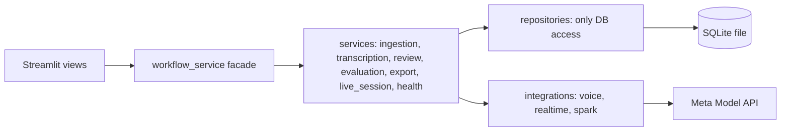

# HakiScribe-AI — Clarity in Every Proceeding

Human-in-the-loop court transcription for Kenyan courts. Built for the **Meta Global Hackathon**.

> **RULE: AI proposes. HUMAN REVIEWS.** Nothing here is official. Every AI output is a draft.
>
> **SYNTHETIC DATA ONLY.** Every case, name, script, and document in this repo is fictional. No real litigants, no real court audio.

## The problem

Preparing accurate court records is slow manual work, and delays hurt
access to justice — especially for appellants waiting on records.
HakiScribe is a prototype review desk that turns a hearing recording
into a draft transcript which a person reviews and corrects, with every
change recorded. It preserves English, Kiswahili, and code-switching
exactly as spoken, and never translates, paraphrases, or adds words.

## What is built

| Capability | Status | Evidence |
|---|---|---|
| Upload and validate synthetic audio | Live | `tests/test_ingestion_v2.py` |
| Batch transcription with speaker turns | Live | `tests/test_transcription_v2.py`, `tests/test_voice_diarization.py` |
| Live microphone transcription | Live | `tests/test_live_transcribe.py` |
| AI review flags (Spark) | Live | `tests/test_spark_review.py` |
| Human review and traceable corrections | Live | `tests/test_human_review.py` |
| Watermarked DOCX draft and WER/CER | Live | `tests/test_draft_export.py` |
| Kenyan-language measurement | Live | `tests/test_language_evaluation.py`, `scripts/evaluate_asr.py` |
| Deletion and API evidence | Live | `tests/test_submission_readiness.py`, `scripts/generate_api_evidence.py` |
| Case request tracking | Planned | `docs/SCOPE-V2.md` |
| Authorised document access | Planned | `docs/SCOPE-V2.md` |
| Wonder public explainer | Parked | `extras/README.md` |
| Image timeline | Parked | `extras/README.md` |
| SAM 3.1 redaction | Parked | `extras/README.md` |
| Glimmer offline draft | Parked | `extras/README.md` |

Planned rows are wider-vision items from the scope doc, not scheduled
work. Parked rows live in `extras/` as reference only.

## Six capabilities, mapped to features

1. **Upload** — validation card (type, size, attestation, SHA-256), one-click demo loader, privacy notice before capture.
2. **Transcribe** — Muse Voice Transcribe in DIARIZATION mode (speaker turns, no invented confidence), plus live microphone capture with approximate timestamps and a batch finalise pass.
3. **AI review** — Muse Spark flags suggestions grouped by severity; hallucinated flags are dropped when evidence is not quoted.
4. **Human review** — two-pane desk with jump-to-audio, original/read-only beside editable text, accept/edit/dismiss/retain decisions, speaker-role assignment, full history, unresolved-issues panel.
5. **Draft export** — watermarked DOCX draft with correction log, unresolved issues, and metrics appendices; never an official or certified record.
6. **Evaluate** — WER/CER of AI vs reviewed text and vs a reference script, speaker attribution, traceability completeness, and review time.

## Architecture



Layer rules (enforced by `tests/test_architecture_rules.py`): the
frontend calls only services; only repositories touch the database;
only integrations call Meta. Details:
[ARCHITECTURE-V2.md](docs/architecture/ARCHITECTURE-V2.md).

## Meta models actually used

- **Muse Voice Transcribe** (`muse-voice-transcribe-1.0`) — batch DIARIZATION and realtime capture.
- **Muse Spark** (`muse-spark-1.1`) — review flags; never modifies the transcript.
- Real Meta calls are proven in [API-EVIDENCE.md](docs/API-EVIDENCE.md), generated from the local call log.

## Setup in five commands

```bash
python -m venv .venv
.venv\Scripts\activate        # Windows
pip install -r requirements.txt
copy .env.example .env        # add META_API_KEY, or leave blank for mock mode
streamlit run frontend/app.py
```

```bash
pytest   # full offline suite
```

## Demo script (5 minutes)

1. Enter a reviewer name, press **Load demo recording**.
2. Press **Transcribe Recording** (mock or real) and read the turns.
3. Open **Review Desk**, press **Run AI review**, open a flag.
4. Play the passage, edit the text, record a decision with a reason.
5. Open **Draft & Evaluation**, generate the DOCX, read the metrics.

Timed version with checklist: [JUDGE-DEMO.md](docs/JUDGE-DEMO.md).

## Evaluation and limitations

- Kenyan-language accuracy is measured, never claimed:
  [evaluation/README.md](evaluation/README.md),
  [EVALUATION.md](docs/EVALUATION.md),
  [LANGUAGE-LIMITATIONS.md](docs/LANGUAGE-LIMITATIONS.md).
- Accuracy can drop with accents, overlapping speech, background noise,
  and mixed languages. Always verify against the audio.
- Mock mode is clearly labelled everywhere and measures nothing.

## Privacy and retention

Audio is sent to the Meta Model API for processing — use only
synthetic or consented recordings. Recordings and exports stay on your
machine (`storage/`, `data/hakiscribe.db`, both gitignored) until you
delete them in the app (Recording panel → Delete, typed confirmation)
or remove the files; deletion keeps only a content-free log entry
(recording id, time, reviewer). Logs and error messages never contain
API keys, audio, or transcript text.

## Scope exclusions

Not provided: no certification, no legal advice, no appeal decisions,
no real records, no deadline or sentencing analysis, no Judiciary
integration. Full list: [SCOPE-V2.md](docs/SCOPE-V2.md).

## Build log

- [HACKATHON-LOG.md](HACKATHON-LOG.md) — proof of new work.
- [MUSE-CODE-LOG.md](MUSE-CODE-LOG.md) — what was built with Muse Code.

## License

MIT — see [LICENSE](LICENSE).
